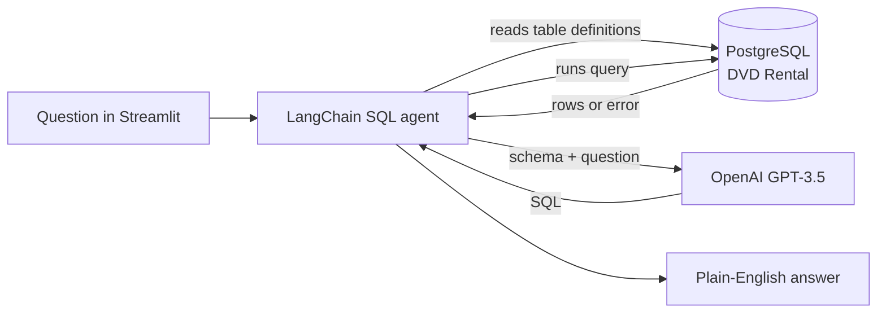
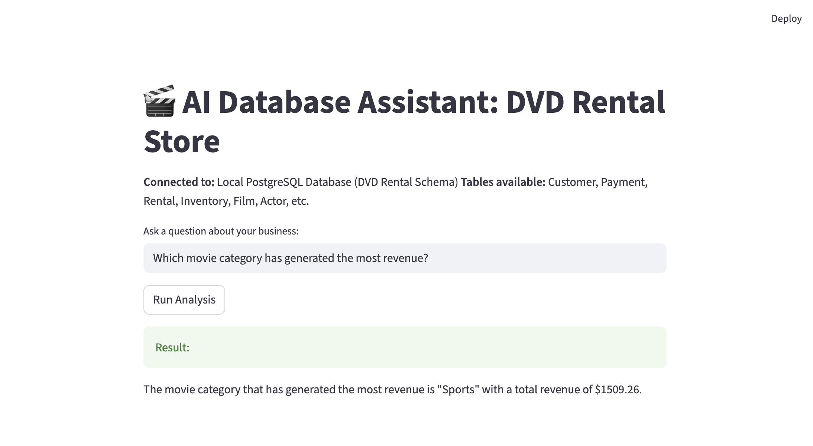

# Natural-Language SQL Assistant

A Streamlit app that answers plain-English questions about a PostgreSQL database. A LangChain SQL agent reads the schema, writes the SQL, runs it, fixes its own errors, and replies in plain language.

**Stack:** Python · LangChain · OpenAI · PostgreSQL · Streamlit

> Part of my portfolio at **[devanshi4.github.io](https://devanshi4.github.io)**

## Highlights

- **Plain English in, multi-table SQL out:** handles questions that need a five-table join.
- **Fixes its own mistakes:** when a query fails, the database error goes back to the model and it tries again.
- **No secrets in the code:** the API key and database password are entered per session and never saved.

---

## The problem

Managers and analysts often need a quick number ("which film category made the most money?"). Getting it means writing a multi-table join they may not know how to write, so they wait on the data team. This app lets them ask the question directly and see the answer in seconds.

## How it works





*The agent answering a question that needs a five-table join: payment → rental → inventory → film → category.*

1. The user enters an OpenAI key and database connection in the sidebar, then asks a question.
2. The agent inspects the relevant table definitions and asks the model for a query.
3. It runs the query on PostgreSQL. If the database returns an error, the agent sends the error back to the model and tries again.
4. The result rows are summarized as a plain-English answer.

## Design decisions

- **An agent, not a single prompt.** A one-shot prompt fails silently when the SQL is wrong. The agent loop sees the database error and corrects the query, which matters for multi-table joins.
- **Schema read at runtime.** The agent looks at the live table definitions instead of a hand-written description, so it stays correct if the schema changes.
- **Deterministic output.** `temperature=0` makes the same question produce the same SQL, which makes answers easier to check.
- **No stored secrets.** The API key and database password are typed into the sidebar each session and are never written to disk or the repo.

## Run it locally

You need Python 3.9+, PostgreSQL with the [DVD Rental sample database](https://neon.com/postgresql/postgresql-getting-started/postgresql-sample-database) restored, and an OpenAI API key.

1. Install dependencies:

   ```bash
   pip install -r requirements.txt
   ```

2. Start the app and fill in the sidebar:

   ```bash
   streamlit run app.py
   ```

For anything beyond a demo, connect with a read-only database user, so a generated query can never change data.

## Project structure

```
├── app.py            # Streamlit UI and LangChain SQL agent
├── requirements.txt
└── demo.png
```

## Status and next steps

- Connect through a read-only role by default and block anything that isn't a `SELECT`.
- Show the generated SQL next to each answer, so users can check it.
- Build a small set of test questions with known answers to measure accuracy when the model or prompt changes.
- Move to a current OpenAI model.

---

Built by **Devanshi Pandya** · [Portfolio](https://devanshi4.github.io) · [LinkedIn](https://www.linkedin.com/in/devanshi4/)
